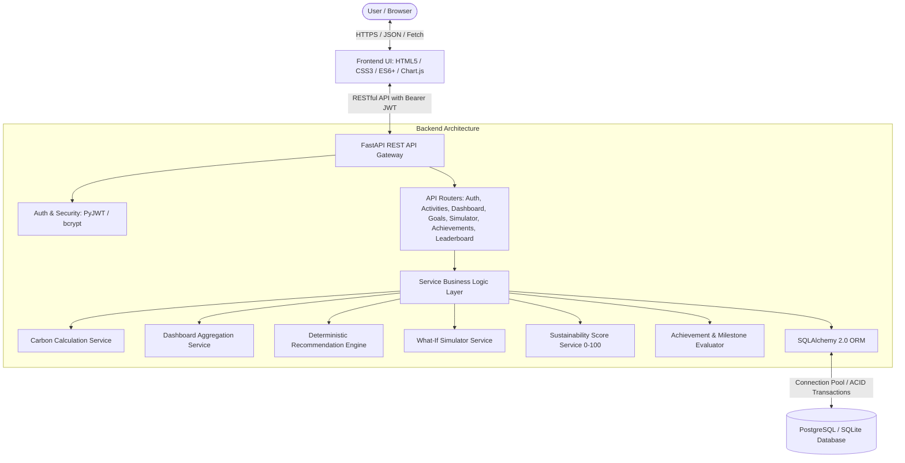
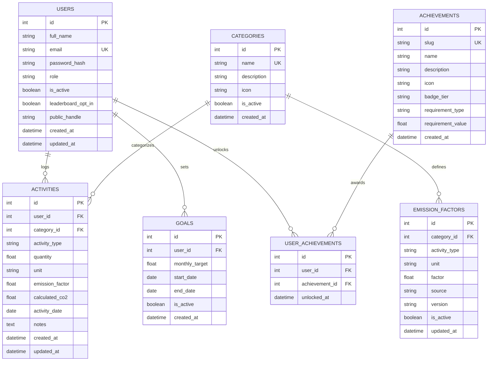

# 🌿 CarbonLens — Carbon Footprint & Sustainability Intelligence Platform

[](https://www.python.org/)
[](https://fastapi.tiangolo.com/)
[](https://www.sqlalchemy.org/)
[](https://www.postgresql.org/)
[](LICENSE)

CarbonLens is an enterprise-grade full-stack carbon footprint tracking and sustainability intelligence SaaS platform. It provides precision carbon accounting across transportation, residential energy, natural gas, commercial aviation, food systems, and consumer goods, converting daily actions into actionable environmental intelligence.

---

## 📌 Core Product Philosophy

$$\text{TRACK} \longrightarrow \text{ANALYZE} \longrightarrow \text{UNDERSTAND} \longrightarrow \text{REDUCE} \longrightarrow \text{IMPROVE}$$

1. **Track**: Log daily carbon-producing and green mitigation activities with dynamic unit conversions and live preview calculations.
2. **Calculate**: Compute estimated $\text{kg CO}_2\text{e}$ utilizing snapshot-preserved emission factors sourced from EPA, DEFRA, and IPCC standards.
3. **Analyze**: Visualize multi-month trendlines, category distributions, daily rhythms, and budget pacing with Chart.js.
4. **Understand**: Discover personalized, deterministic reduction tips targeting your largest emission categories.
5. **Reduce**: Model reduction scenarios in the **"What-If" Simulation Laboratory**, showing monthly/annual carbon savings, tree equivalents, and avoided driving distance.
6. **Improve**: Earn tiered milestone badges and compete on a privacy-safe community leaderboard via the transparent **CarbonLens Sustainability Score**.

---

## 🏗️ System Architecture



---

## 🧰 Technology Stack

| Layer | Technology | Rationale |
|---|---|---|
| **Backend** | Python 3.12+, FastAPI, Uvicorn | High-throughput asynchronous ASGI web framework with native OpenAPI/Swagger generation. |
| **Data & ORM** | SQLAlchemy 2.0, PostgreSQL, SQLite | Clean ORM with robust aggregation queries (`func.sum`, `func.count`) and zero-config local fallback. |
| **Validation & Settings** | Pydantic v2, Pydantic Settings | Strict type-safety, automatic input serialization, and `.env` parsing. |
| **Authentication** | PyJWT, Passlib, Bcrypt | HMAC-SHA256 bearer tokens with salted bcrypt password hashing and role-based authorization. |
| **Frontend** | Vanilla ES6+ JavaScript, Semantic HTML5, Custom CSS3 | Fast, zero-build dependency, responsive UI featuring responsive glassmorphism and mobile drawer navigation. |
| **Visualizations** | Chart.js 4.4+ | Interactive, responsive doughnut, multi-axis bar, and timeline line charts. |
| **Testing** | Unittest, FastAPI TestClient, HTTPX | Comprehensive integration test coverage for authentication, calculations, and security isolation. |

---

## 🗄️ Database Schema Design



---

## 🔬 Carbon Calculation Engine

Emissions are estimated using verified carbon intensity factors and the standard equation:

$$\text{Estimated Carbon Footprint } (\text{kg CO}_2\text{e}) = \text{Quantity} \times \text{Emission Factor}$$

### Snapshot Factor Preservation
When an activity is logged, the active emission factor is stored directly on the activity record. If conversion factors are revised in future regulatory updates, historical activity totals remain mathematically immutable.

### Configurable Conversion Table Sample
| Category | Activity Type | Unit | Factor ($\text{kg CO}_2\text{e}/\text{unit}$) | Primary Source |
|---|---|---|---|---|
| **Transportation** | Car (Gasoline) | km | `0.192` | EPA 2024 GHG Hub |
| **Transportation** | Car (Electric / EV) | km | `0.053` | DEFRA 2024 Conversion |
| **Transportation** | Train / Rail | km | `0.041` | DEFRA 2024 Conversion |
| **Transportation** | Bicycle / Walking | km | `0.000` | Zero Direct Emissions |
| **Electricity** | Grid Electricity | kWh | `0.385` | EPA eGRID 2024 National Average |
| **Electricity** | Renewable Power | kWh | `0.015` | NREL Lifecycle Analysis |
| **Natural Gas** | Natural Gas (Heating) | $\text{m}^3$ | `2.030` | DEFRA 2024 Fuel Factors |
| **Flights** | Short-Haul (< 500 km) | km | `0.255` | DEFRA 2024 Aviation |
| **Flights** | Long-Haul (> 3700 km) | km | `0.150` | DEFRA 2024 Aviation |
| **Food & Diet** | Meal (Meat-Heavy / Beef) | meals | `3.300` | Poore & Nemecek Science (2018) |
| **Food & Diet** | Meal (Plant-Based / Vegan) | meals | `0.500` | Poore & Nemecek Science (2018) |
| **Shopping** | Consumer Goods Purchase | USD | `0.350` | USEEIO 2.0 Input-Output |

---

## ⚡ Quick Start & Installation

### Prerequisites
- Python 3.12 or newer
- (Optional) PostgreSQL database (defaults to instant SQLite out of the box)

### 1. Clone & Setup
```bash
git clone https://github.com/your-username/carbonlens.git
cd carbonlens
```

### 2. Install Dependencies
```bash
pip install -r backend/requirements.txt
```

### 3. Configure Environment
Copy the example environment file:
```bash
cp .env.example .env
```

### 4. Launch Application (One Command)
```bash
python run.py
```
Or start via Uvicorn directly:
```bash
cd backend
uvicorn app.main:app --reload --port 8000
```

### 5. Access Interfaces
- **Web Application**: [http://127.0.0.1:8000](http://127.0.0.1:8000)
- **Interactive OpenAPI / Swagger Docs**: [http://127.0.0.1:8000/docs](http://127.0.0.1:8000/docs)
- **ReDoc API Documentation**: [http://127.0.0.1:8000/redoc](http://127.0.0.1:8000/redoc)

---

## 🔑 Pre-Seeded Evaluation Credentials

The application automatically seeds reference categories, emission factors, default achievements, and a demo profile on first boot:

| Account | Email | Password | Role | Description |
|---|---|---|---|---|
| **Demo User** | `demo@carbonlens.dev` | `CarbonLens2026!` | User | Preloaded with multi-month activity logs across all categories, unlocked badges, and active goal. |
| **Administrator** | `admin@carbonlens.dev` | `AdminCarbonLens2026!` | Admin | Access to platform-wide statistics, user activation management, and emission factor creation. |

*(A 1-click **"Fill Demo Account Credentials"** button is also built into the login screen).*

---

## 🧪 Running Automated Tests

Run the full automated test suite covering authentication, calculation precision, activity ownership isolation, budget tracking, simulator formulas, and achievements:

```bash
cd backend
python -m unittest tests.test_api
```

---

## 📡 REST API Reference Summary

### Authentication (`/api/v1/auth`)
- `POST /register`: Create new user account with validation & default budget.
- `POST /login`: Authenticate and obtain JWT bearer access token.
- `POST /login-form`: OAuth2 password flow endpoint for Swagger UI testing.
- `GET /me`: Retrieve current user profile.
- `PUT /me`: Update profile preferences & public leaderboard handle.
- `POST /change-password`: Secure password change.

### Activities (`/api/v1/activities`)
- `GET /preview`: Live CO₂e preview calculation before persistence.
- `GET /`: List paginated activities with date range, category, and keyword search filters.
- `POST /`: Log new activity, snapshot conversion factor, and evaluate achievements.
- `GET /{id}`: Retrieve single activity (enforces user ownership).
- `PUT /{id}`: Update quantity/date with automatic CO₂e recalculation.
- `DELETE /{id}`: Delete activity record.

### Dashboard & Analytics (`/api/v1/dashboard`)
- `GET /summary`: Aggregated monthly footprint, MoM delta %, daily rate, goal status, sustainability score, and charts data.
- `GET /category-breakdown`: Category distribution for doughnut visualization.
- `GET /monthly-trend`: 6-month historical trendline with target budget overlay.
- `GET /recent-activities`: Latest 10 activities for quick table display.

### Carbon Budget & Goals (`/api/v1/goals`)
- `GET /current`: Active monthly carbon target, percentage consumed, and coaching status.
- `POST /`: Set or revise monthly carbon allowance.
- `GET /history`: Historical carbon budget records.

### Simulation Laboratory (`/api/v1/simulator`)
- `GET /presets`: Preconfigured high-impact reduction scenarios.
- `POST /calculate`: Compute baseline vs projected emissions, monthly/annual savings, tree-equivalents, and avoided driving distance.

### Smart Recommendations (`/api/v1/recommendations`)
- `GET /`: Deterministic recommendations tailored to the user's top emission drivers.

### Achievements & Badges (`/api/v1/achievements`)
- `GET /`: All achievements with unlocked status, unlock timestamps, and current progress %.
- `GET /unlocked`: Only unlocked badges.

### Community Leaderboard (`/api/v1/leaderboard`)
- `GET /`: Privacy-safe leaderboard ranked by Sustainability Score (0–100) and reduction performance.

### Categories & Factors (`/api/v1/categories`)
- `GET /`: List all active emission categories and conversion factors.

### Administration (`/api/v1/admin`)
- `GET /stats`: Platform-wide stats (total users, activities logged, total emissions).
- `GET /users`: List users with activity counts and total footprints.
- `PUT /users/{id}/status`: Toggle user role and active state.
- `POST /emission-factors`: Register custom emission factor.

---

## 🔒 Security Practices

- **Zero Plaintext Passwords**: Bcrypt with automatic salt generation via `passlib`.
- **JWT Cryptography**: Signed with HMAC-SHA256, expiration timestamps, and subject claims.
- **Server-Side Authorization**: Every activity and goal endpoint checks `activity.user_id == current_user.id` to prevent Insecure Direct Object References (IDOR).
- **Injection Prevention**: 100% parameterized queries managed through SQLAlchemy ORM.
- **Input Sanitization**: Pydantic v2 schemas reject malformed numbers, invalid dates, and invalid emails before entering the service layer.
- **CORS Configuration**: Restrictable explicit origins for production deployments.

---

## 🚀 Deployment & Production Guidelines

### Using PostgreSQL in Production
1. Set the PostgreSQL connection string in your production environment:
   ```env
   DATABASE_URL=postgresql://db_user:db_password@db_host:5432/carbonlens_prod
   ```
2. Run with production Uvicorn workers:
   ```bash
   uvicorn app.main:app --host 0.0.0.0 --port 8000 --workers 4
   ```

---

## 📄 License
This project is open-source under the MIT License.
